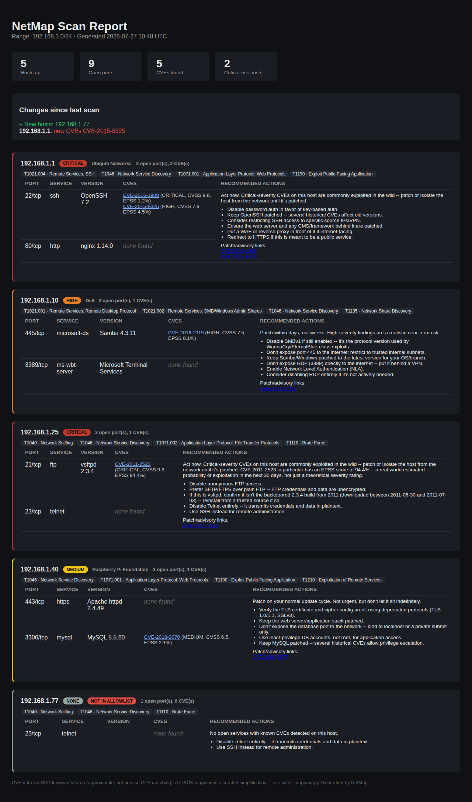
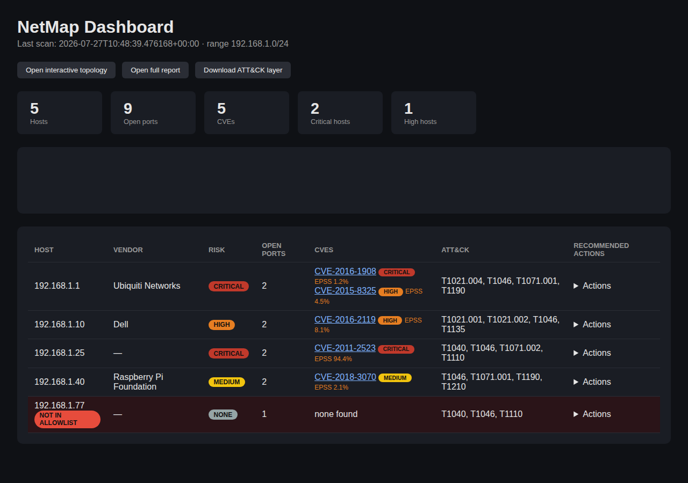
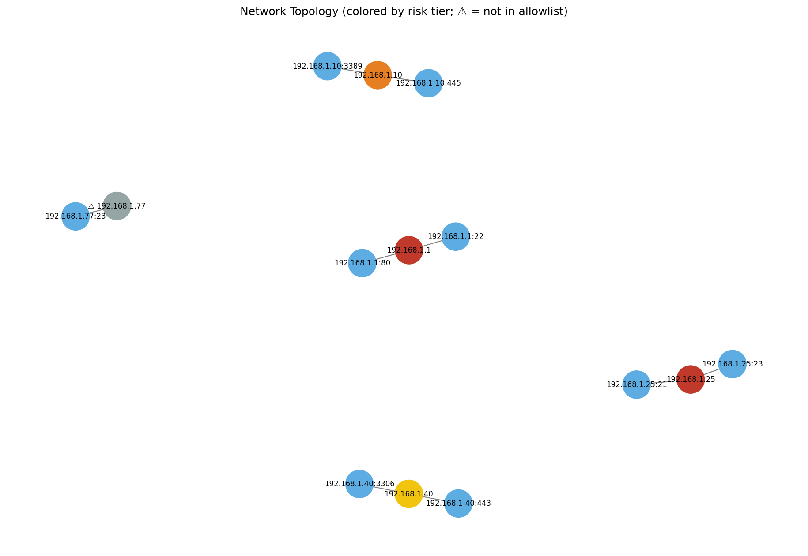

# NetMap — Network Topology Visualizer


[](https://github.com/modithakolli/NetMap/actions/workflows/tests.yml)


A Python tool that scans a network, discovers active hosts and their
services, enriches each service with known CVEs (prioritized by real-world
exploitation likelihood via EPSS, not just theoretical severity), maps
exposures to MITRE ATT&CK techniques, flags devices that shouldn't be
there, and puts all of it on a live dashboard with concrete mitigation
steps.

> **Scope/ethics note:** only point this at networks and hosts you own
> or are explicitly authorized to scan. Port/service scanning against
> systems you don't control can be illegal even when well-intentioned.

## Why NetMap?

NetMap isn't trying to replace enterprise vulnerability scanners like
Nessus or OpenVAS — those do active, verified checks with huge
professionally-maintained plugin libraries, and for production use they're
the right call (see [`COMPARISON.md`](COMPARISON.md) for an honest
breakdown of that tradeoff). What NetMap does instead is combine network
discovery, CVE enrichment, EPSS-based prioritization, ATT&CK mapping,
rogue-device detection, and historical tracking into a single lightweight,
fully-readable, open-source Python tool — suitable for home labs,
security research, and learning how a scanner like this actually works
under the hood, since every scoring/mapping decision is a Python file you
can open and read, not a proprietary plugin.

## Screenshots

**Full report** — per-host risk, real CVE IDs with CVSS/EPSS, and
recommended actions:



**Live dashboard** — current state, trend chart, expandable mitigation
guidance:



**Topology graph** — colored by risk tier, ⚠ marks a device not in your
allowlist (this is the Matplotlib static fallback; the default interactive
`pyvis` graph looks similar with hover tooltips):



## Features

- **Host & service discovery** — nmap ping/ARP sweep + `-sV` service
  fingerprinting + MAC capture, across one subnet, several
  (`--range a,b`), or auto-detected (`--range auto`)
- **CVE enrichment** — NVD keyword search per service+version, SQLite
  cached. *(Keyword-based, not exact CPE matching — see
  [Known limitations](#known-limitations) before treating results as
  authoritative.)*
- **EPSS-aware prioritization** — combines CVSS (severity) with
  [EPSS](https://www.first.org/epss/) (real-world exploitation
  probability from FIRST.org) so priority reflects actual risk, not just
  theoretical severity
- **Risk scoring & mitigation guidance** — CVSS/EPSS aggregated into a
  risk tier per host, plus hardening bullets and real NVD-sourced
  patch/advisory links
- **MITRE ATT&CK mapping** — exposed services mapped to Enterprise ATT&CK
  techniques, exportable as an
  [ATT&CK Navigator](https://mitre-attack.github.io/attack-navigator/) layer
- **Rogue/unrecognized device detection** — flags hosts not in a
  known-good allowlist ([docs](docs/rogue-devices.md))
- **MAC vendor / OUI lookup** — best-effort asset fingerprinting
- **OSINT (optional)** — Shodan + WHOIS for public-facing IPs
- **Alerting** — email/Slack on new hosts, new CVEs, or rogue devices
  ([docs](docs/alerting.md))
- **Optional Nuclei integration** — active confirmation beyond passive
  CVE lookup ([docs](docs/nuclei.md))
- **Interactive topology graph** (pyvis, static Matplotlib fallback),
  **self-contained HTML report**, and a **live Flask dashboard**
  ([docs](docs/dashboard.md))
- **Historical diffing** — new/closed ports, new CVEs, new hosts, snapshot
  over time
- **Demo mode** (`--demo`) — full pipeline on synthetic data, zero setup

## Quick start

```bash
pip install -r requirements.txt
python main.py --demo
python dashboard.py   # -> http://127.0.0.1:5000
```

No nmap, no root, no API keys needed for this — it uses synthetic sample
data so you can see the whole pipeline immediately.

## Install

| Platform | Status |
|---|---|
| Linux | ✅ Recommended |
| macOS | ✅ Supported |
| Windows | ⚠️ Works, but needs nmap installed separately and Administrator privileges for service/OS detection |

Python 3.10+ (developed/tested on 3.11).

```bash
pip install -r requirements.txt
```

You'll also need the `nmap` binary itself on your PATH (`apt install nmap`
/ `brew install nmap` / [Windows installer](https://nmap.org/download.html)).
Service (`-sV`) and OS (`-O`) detection typically require root/Administrator.

Optional environment variables:

```bash
export NVD_API_KEY=...     # raises NVD rate limits substantially; get one free at
                            # https://nvd.nist.gov/developers/request-an-api-key
export SHODAN_API_KEY=...  # required for --shodan OSINT lookups
```

## Usage

```bash
# Real scan of your local subnet, full pipeline:
sudo python main.py --range 192.168.1.0/24

# Faster, offline (skip CVE + EPSS + OSINT lookups):
python main.py --range 192.168.1.0/24 --no-cve

# Bootstrap a device allowlist, then scan with rogue-device detection +
# MAC vendor lookup + Slack alerting on:
sudo python main.py --range 192.168.1.0/24 --init-allowlist
sudo python main.py --range 192.168.1.0/24 --alert-slack
```

See `python main.py --help` for the full flag list, or the `docs/` folder
for [multi-subnet scanning](docs/scanning.md),
[rogue-device detection](docs/rogue-devices.md),
[alerting](docs/alerting.md), [Nuclei](docs/nuclei.md), and the
[dashboard](docs/dashboard.md) in detail.

Each run produces:

| File | What it is |
|---|---|
| `scan_results.json` | Raw structured scan data |
| `topology.html` | Interactive risk-colored network graph |
| `report.html` | Human-readable summary report, incl. diff vs. last scan |
| `attack_navigator_layer.json` | Import into ATT&CK Navigator for a technique heatmap |
| `history/scan_*.json` | Timestamped snapshots for historical diffing |

### Example report output

What a flagged host looks like (abbreviated — the real report includes
mitigation steps and patch links too):

```
Host: 192.168.1.15                                    Risk: HIGH

Open services
  22/tcp   ssh    OpenSSH 8.2
  80/tcp   http   Apache 2.4.49

CVEs
  CVE-2021-41773  (CRITICAL, CVSS 9.8, EPSS 94.1%)
  CVE-2021-42013  (CRITICAL, CVSS 9.8, EPSS 93.8%)

ATT&CK
  T1190  Exploit Public-Facing Application
  T1021.004  Remote Services: SSH

Recommended action
  Act now — EPSS indicates active real-world exploitation.
  Upgrade Apache to 2.4.51+.
```

## Performance

Demo mode (`--demo --no-cve`, 5 synthetic hosts, no network calls)
completes in well under a second — measured directly, not estimated.

Real scans depend heavily on your network size, nmap's `-sV` fingerprinting
time, and CVE lookup rate limits — those aren't things I can honestly
benchmark from here with fabricated numbers, since they depend on your
hardware, network, and whether you have an `NVD_API_KEY`:
- **Without** an NVD API key, CVE lookup sleeps ~6s per unique
  service+version before each request (NVD's published unauthenticated
  rate limit) — this dominates total runtime on anything beyond a couple
  of hosts.
- **With** a free NVD API key, that drops to well under a second per
  request, so nmap's own scan time (not CVE lookup) becomes the
  bottleneck instead.
- `--no-cve` skips CVE lookup entirely for a pure-discovery run, useful
  for a quick topology check.

If you want real numbers for a report, time your own run with
`time python main.py --range <your-range>` — that's a real measurement
for your environment, which is more honest than a number I'd have to
make up.

## Architecture

```
scanner.py        -> nmap host discovery + service/version + MAC detection
cve_lookup.py      -> NVD API lookup + SQLite cache (incl. patch/advisory refs)
epss.py             -> FIRST.org EPSS lookup + CVSS/EPSS combined priority
risk.py            -> CVSS aggregation -> per-host risk tier
mitre_mapping.py    -> service -> ATT&CK technique table + Navigator export
mitigation.py        -> priority + hardening guidance + sourced patch links
oui.py                -> MAC -> vendor lookup (asset inventory)
inventory.py            -> allowlist loading + rogue-device flagging
alerting.py               -> email/Slack notifications
nuclei_scan.py             -> optional active scanning via the Nuclei binary
osint.py            -> Shodan / WHOIS enrichment for public IPs (cached)
history.py          -> scan snapshotting + diffing
topology.py          -> builds a NetworkX graph with risk/technique metadata
visualizer.py         -> pyvis interactive graph (Matplotlib static fallback)
report.py              -> Jinja2 HTML report (autoescaped)
storage.py               -> JSON persistence
main.py                    -> orchestrates the above
dashboard.py                -> Flask dashboard over scan_results.json + history/
```

## Evaluation & comparison

`eval/` has a precision/recall evaluation harness against Metasploitable2
(a practice VM with publicly documented vulnerabilities) — see
[`eval/README.md`](eval/README.md) for what's already verified (the
harness logic, against a synthetic fixture) vs. what you run yourself
against a real VM to get citable numbers. [`COMPARISON.md`](COMPARISON.md)
has an honest feature/tradeoff comparison against Nessus and OpenVAS.

## Known limitations

- **CVE matching is keyword-based, not precise CPE matching.** nmap
  banners don't reliably give you a vendor, so this queries NVD's
  `keywordSearch` with "`product version`" rather than building an
  exact CPE 2.3 string. Good enough for a demo/research tool, not a
  substitute for a real vulnerability scanner (Nessus/OpenVAS) in
  production. See `ROADMAP.md` for the CPE-matching upgrade path.
- **The ATT&CK mapping is a small hand-curated table**, not the full
  live ATT&CK dataset. Treat it as illustrative.
- **OSINT only applies to public IPs** — private/RFC1918 addresses
  aren't indexed by Shodan/WHOIS, so a typical home/lab scan won't
  trigger much there.

See [`AUDIT.md`](AUDIT.md) for a fuller self-review, including a
stored-XSS bug that was found and fixed.

## Roadmap

See [`ROADMAP.md`](ROADMAP.md) for planned/considered future work: exact
CPE-based matching, a richer risk model, asset fingerprinting, a plugin
architecture, async scanning, a REST API, and packaging.

## Tests

```bash
pip install pytest
pytest tests/
```

Tests cover risk scoring, ATT&CK mapping/Navigator export, EPSS
integration, mitigation guidance, rogue-device detection, report
rendering (including the XSS-escaping and zero-open-services edge
cases), the Flask dashboard's routes/auth, and the evaluation harness
itself — all mocked at the network boundary, so no live network is
needed to run them. CI runs this on every push
(`.github/workflows/tests.yml`).

## Continuous integration and security checks

Every push and pull request runs three GitHub Actions jobs
([`tests.yml`](.github/workflows/tests.yml)):

- **tests** - the pytest suite (network calls are mocked)
- **security-scans** - bandit (static analysis, medium severity and above),
  pip-audit (known vulnerabilities in `requirements.txt`) and gitleaks
  (secrets detection)
- **docker-build** - builds the image from the `Dockerfile`

## Docker

```bash
docker build -t netmap .
docker run --cap-add=NET_RAW --cap-add=NET_ADMIN netmap --demo
```

(`NET_RAW`/`NET_ADMIN` are needed for nmap's raw-socket scans; omit them
if you're only ever using `--demo`.)

## License

MIT — see [`LICENSE`](LICENSE).

## Contributing

Issues and PRs welcome. If you're extending this, `AUDIT.md` and
`ROADMAP.md` are good starting points for context on what's already been
considered and why things are built the way they are.
